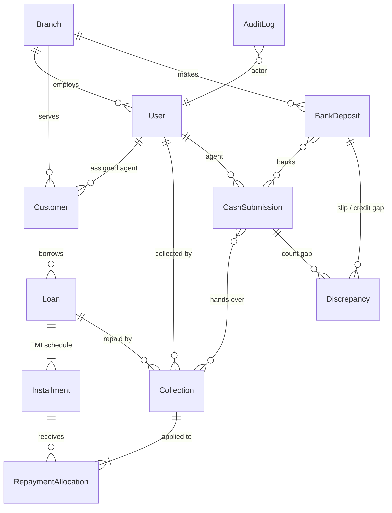

# Architecture, data model and business rules

## 1. Problem understanding

Cash changes hands four times before it is safe in the company's account, and each hand-off is a place
where money can be lost, delayed, double-counted or quietly edited. The system therefore models **custody**,
not just payments: at any moment every receipt is in exactly one custodian's hands, every hand-off compares
what *should* arrive with what *did*, and any gap becomes a tracked **discrepancy** attributed to the stage
(and person) where it occurred.

| Stage | Custodian | Document | Check performed |
|---|---|---|---|
| Expected | Customer | Instalment (EMI schedule) | — |
| Collected | Agent | Receipt `RCP-…` | ≤ outstanding, not a duplicate, ≤ statutory cash limit |
| Branch received | Branch manager | Hand-over `SUB-…` | receipts total vs cash physically counted |
| Bank deposited | Bank (in transit) | Deposit `DEP-…` + bank reference | branch-verified cash vs deposit slip; unique bank reference |
| Settled | Company account | Statement credit | deposit slip vs amount credited; SLA for delays |

## 2. System architecture

```
┌──────────────────────────┐   HTTPS + JWT    ┌───────────────────────────────────────────────┐
│ React 19 + TypeScript    │ ───────────────► │ Django REST Framework                          │
│ (Vite SPA on Vercel)     │  JSON, money as  │  views      → permissions (role) + scoping   │
│  • React Query cache     │  decimal strings │  serializers→ validation / shape              │
│  • paise BigInt maths    │ ◄─────────────── │  services   → business rules, transactions,   │
│  • role-aware navigation │  {error:{code}}  │               row locks, audit, discrepancies │
└──────────────────────────┘                  │  models     → invariants, GuardedModel        │
                                              └──────────────────────┬────────────────────────┘
                                                                     │ ATOMIC_REQUESTS
                                              ┌──────────────────────▼────────────────────────┐
                                              │ PostgreSQL 16                                 │
                                              │  NUMERIC(14,2) money · CHECK constraints      │
                                              │  unique bank ref (case-insensitive)           │
                                              │  immutability triggers · append-only audit    │
                                              └───────────────────────────────────────────────┘
```

**Layering.** Views are thin: they authenticate, check the role, scope the queryset and call one service
function. All state changes live in `apps/*/services.py`, each wrapped in a transaction that takes
`SELECT … FOR UPDATE` locks on the rows it changes. This is where every business rule is enforced, so the
same rules apply whether the caller is the API, the seed command or a future batch job.

**Defence in depth for money.** Each critical rule is enforced at more than one layer:

| Rule | Service | Model | Database |
|---|---|---|---|
| No over-collection | outstanding check under loan row lock | — | `CHECK total_paid <= total_payable`, `CHECK amount_paid <= amount_due` |
| No duplicate receipts | idempotency key lookup + duplicate window | — | `UNIQUE idempotency_key`, `UNIQUE receipt_number` |
| No duplicate bank reference | lookup with clear error | — | `UNIQUE (lower(bank_name), lower(reference_number))` |
| Reconciled records are frozen | status checks (`RECORD_LOCKED`) | `GuardedModel.save()/delete()` | `BEFORE UPDATE/DELETE` triggers on receipts and deposits |
| Audit trail can't be altered | — | `AuditLog.save()` refuses updates | trigger blocks `UPDATE`/`DELETE` |

## 3. Database design



| Table | Purpose | Key columns / constraints |
|---|---|---|
| `core_branch` | Branch master | `code` unique (appears in document numbers) |
| `accounts_user` | Staff login + role | `role` ∈ ADMIN, FINANCE, BRANCH_MANAGER, AGENT; CHECK branch staff have a branch |
| `lending_customer` | Borrower | `customer_code` unique; `branch`; `assigned_agent` |
| `lending_loan` | Loan terms + running totals | `principal`, `annual_interest_rate`, `tenure_months`, `emi_amount`, `total_payable`, `total_paid`; CHECKs incl. paid ≤ payable |
| `lending_installment` | Schedule row | unique (`loan`, `installment_number`); `amount_paid ≤ amount_due` |
| `cash_collection` | A receipt | `receipt_number` unique, `idempotency_key` unique, `amount > 0`, `status`, denormalised `branch`/`customer` for fast scoping; immutability trigger |
| `cash_repaymentallocation` | Receipt → instalment split | lets a void be reversed exactly; full repayment history per EMI |
| `cash_cashsubmission` | Agent → branch hand-over | `expected_amount` (system), `declared_amount` (agent), `received_amount` (manager), `difference` |
| `cash_cashsubmission_collections` | M2M | keeps history: a rejected and a re-submitted hand-over both reference the same receipts |
| `banking_bankdeposit` | Branch → bank, and settlement | `reconciled_amount`, `amount`, `deposit_difference`, `settled_amount`, `settlement_difference`, `status`; unique bank reference; trigger freezes figures |
| `banking_bankdeposit_submissions` | M2M | a submission can appear in a FAILED deposit and later in a new one |
| `reconciliation_discrepancy` | Any gap between two figures | `stage`, `direction`, `expected_amount`, `actual_amount`, `amount`, `status`, resolution fields; CHECK has a source |
| `core_auditlog` | Append-only change log | actor, action, entity, `changes` JSON, IP; trigger blocks edits |
| `core_documentsequence` | Gap-free counters | row-locked per prefix/branch/day |

**Design decisions**

* **Money** is `NUMERIC(14,2)` end to end. The API serialises it as strings (`"1500.00"`); the frontend does
  any arithmetic (selected totals, live differences) in integer paise with `BigInt`. No float ever touches
  an amount; `to_money()` refuses floats outright.
* **Status lives on the receipt.** The receipt's status tells you where its cash physically is, which makes
  "cash held by agents" or "deposited but not settled" a single indexed query. Submissions and deposits
  are many-to-many so history survives rejections and failed deposits.
* **`loan.total_paid` is denormalised** and updated under a row lock, so outstanding balances are O(1) and
  the over-collection guard can be a database `CHECK`.
* **Gap-free, human-readable numbers** (`RCP-MUM01-20261015-00004`) from a locked counter table rather
  than database sequences, which can skip values on rollback — auditors expect gap-free receipt books.

## 4. Key workflows

1. **Record repayment** (agent) — `POST /collections/` with a client-generated `idempotency_key`. The loan
   row is locked, limits checked, the receipt numbered, and the amount allocated oldest-instalment-first.
2. **Hand over cash** (agent) — `POST /submissions/` with the receipt ids and the cash declared. Receipts
   move to `SUBMITTED` and can no longer be voided.
3. **Verify** (manager) — `approve` with the counted amount (notes required if it differs → `SUBMISSION`
   discrepancy against the agent) or `reject` with a reason (receipts go back to the agent's custody).
4. **Bank it** (manager) — `POST /deposits/` selecting approved hand-overs. Deposit is checked against
   the *counted* cash, not the receipts total. Different slip amount needs a reason → `DEPOSIT` discrepancy.
5. **Settle** (finance) — `settle` with the statement credit (difference → `SETTLEMENT` discrepancy and
   `SETTLEMENT_MISMATCH` status), or `fail` (cash treated as back in the branch safe; re-deposit with a new
   reference). Deposits older than the SLA and still pending show as *delayed*.
6. **Resolve** — managers resolve their branch's agent and deposit discrepancies; Finance resolves bank ones.

## 5. Business cases from the brief

| Case | Handling | Test |
|---|---|---|
| Partial repayment | Any amount up to outstanding; FIFO allocation marks instalments `PARTIALLY_PAID`; spill-over across EMIs | `test_partial_payment_then_spill_over` |
| Over-collection | Rejected with `OVER_COLLECTION` (shows outstanding & excess); DB CHECK as backstop | `test_over_collection_rejected`, `test_db_rejects_paid_above_payable` |
| Duplicate collection | (a) idempotency key: retry returns the original receipt, HTTP 200; (b) same loan + amount within 30 min → `POSSIBLE_DUPLICATE` (409) unless the agent confirms it's a separate payment | `test_idempotent_retry_returns_same_receipt`, `test_possible_duplicate_needs_confirmation` |
| Cash discrepancy | Manager enters counted cash; any difference requires notes and raises a SHORTAGE/EXCESS discrepancy against the agent | `test_shortage_records_discrepancy_against_agent`, `test_excess_cash_is_recorded` |
| Rejected cash submission | Reason required; receipts return to `COLLECTED` (agent still accountable); re-submission keeps history | `test_rejection_returns_cash_to_agent_and_allows_resubmission` |
| Bank deposit mismatch | Slip ≠ verified cash → reason required + `DEPOSIT` discrepancy; credit ≠ slip → `SETTLEMENT_MISMATCH` + discrepancy | `test_deposit_mismatch_needs_reason_and_raises_discrepancy`, `test_settlement_mismatch` |
| Duplicate bank reference | Case/space-insensitive unique per bank; friendly `DUPLICATE_BANK_REFERENCE` error; DB unique index | `test_duplicate_bank_reference_rejected_case_insensitive` |
| Unauthorized modification of reconciled transactions | No update endpoints for financial records; status-guarded services; `GuardedModel`; PostgreSQL triggers; read-only Django admin; append-only audit log | `test_reconciled_receipt_cannot_be_edited`, `test_settled_deposit_is_frozen`, `test_audit_log_is_append_only` |
| Failed settlement | `fail` → deposit `FAILED`, receipts back to `BRANCH_RECEIVED`, submissions re-depositable | `test_failed_deposit_releases_cash_for_redeposit` |
| Delayed settlement | Pending beyond `SETTLEMENT_SLA_DAYS` → *delayed* flag, dashboard warning, `?delayed=true` filter | `test_delayed_settlement_flag` |
| Concurrency (double approval, double tap) | `SELECT … FOR UPDATE` on loan / submission / deposit; status re-checked inside the lock | `test_submission_cannot_be_reviewed_twice` |
| Cross-branch access | Row scoping returns 404 for other branches' records; services re-check branch | `test_manager_of_other_branch_cannot_review` |

## 6. Assumptions

1. **The customer's debt is discharged when the agent issues a receipt.** The receipt is the customer's
   proof of payment, so the loan is credited immediately; any later loss is the agent's or branch's
   liability, tracked as a discrepancy — never re-billed to the customer.
2. **No advance or excess payments.** A receipt can't exceed the loan outstanding. (Prepayment/foreclosure
   would be a separate product rule.)
3. **Allocation is oldest instalment first**, combined principal + interest. No penal interest or fees.
4. **Reducing-balance EMI**, monthly, first EMI one month after disbursement; rounding drift is absorbed by
   the last instalment so principal sums exactly.
5. **Single cash receipt limit of ₹1,99,999.99** (Income Tax Act s.269ST), configurable.
6. **Receipts can be voided only while the cash is still with the agent** (status `COLLECTED`), with a reason.
   After hand-over, corrections go through the discrepancy process, never edits.
7. **Hand-overs are approved or rejected whole.** Approving with a shortage is allowed (the cash is real and
   should be banked); the gap is recorded against the agent.
8. **A deposit banks whole hand-overs** and is measured against cash *counted* at the branch.
9. **A deposit is settled once**, from the bank statement; a settlement mismatch doesn't block settlement —
   the money reached the bank — but raises a discrepancy for Finance.
10. **A failed deposit means the cash is back in the branch** (e.g. slip returned). The original bank
    reference stays used; re-depositing needs a new one.
11. **One agent per customer**, both in the customer's branch. Customers with active loans can't change branch.
12. **Business day = Asia/Kolkata.** Receipt numbers, "today" and report date filters use local dates.
13. Only cash is in scope; UPI/digital collection is designed for but not built (see README).

## 7. Technology choices and trade-offs

| Choice | Why | Trade-off |
|---|---|---|
| Django + DRF | Mature ORM with transactions, row locks, constraints and migrations; DRF gives filters, pagination, schema | Heavier than FastAPI; fine for a CRUD + workflow system |
| PostgreSQL | `NUMERIC`, `CHECK`, expression unique indexes, `FOR UPDATE`, triggers | Tests need a real Postgres (CI provides one) |
| Service layer over fat models/views | One place for rules, locks and audit; testable without HTTP | More files per app |
| JWT (SimpleJWT) with rotation + blacklist | Stateless API across Vercel/Render domains, no CSRF dance | Tokens in `localStorage` are XSS-exposed; mitigated by short access life and rotation; httpOnly cookies listed as an improvement |
| Swagger (drf-spectacular) | Interactive API docs generated from code — satisfies API docs requirement without drift | — |
| Pytest | Concise fixtures for multi-role scenarios | — |
| Docker Compose | One-command local stack identical to production topology | Optional; plain venv path documented |
| React Query | Caching, refetch on focus, cache invalidation after mutations | — |
| No Redis/Celery | Nothing in scope needs async work; SLA "delayed" is computed at read time | Scheduled alerts would need it (listed as an improvement) |
| No payment gateway | Kept scope on the core cash workflow and its correctness | UPI flow described, not built |

## 8. Challenges encountered

* **Defining "expected" amounts.** A hand-over is expected to equal its receipts; a deposit is expected to
  equal what the manager *counted* (not the receipts) — otherwise one agent shortage would echo as a second,
  false discrepancy at the bank stage.
* **History vs current state.** Rejections and failed deposits mean the same receipt can belong to several
  hand-overs/deposits over time; solved with many-to-many links plus status on the receipt.
* **Making immutability real.** ORM-level guards are bypassable by `queryset.update()`; PostgreSQL
  triggers close that gap, and tests prove a raw `UPDATE` is refused.
* **Float-free frontend.** JavaScript numbers are floats, so the UI does money maths in paise with `BigInt`
  and formats decimal strings directly.
